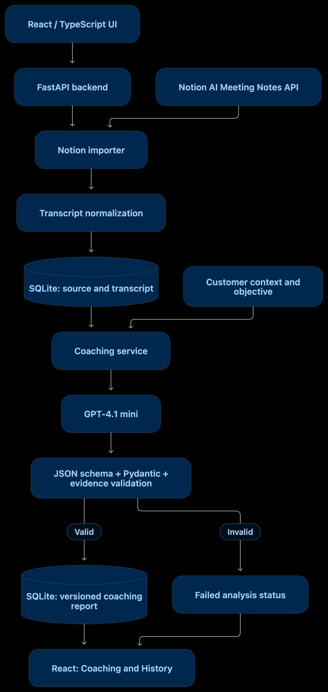
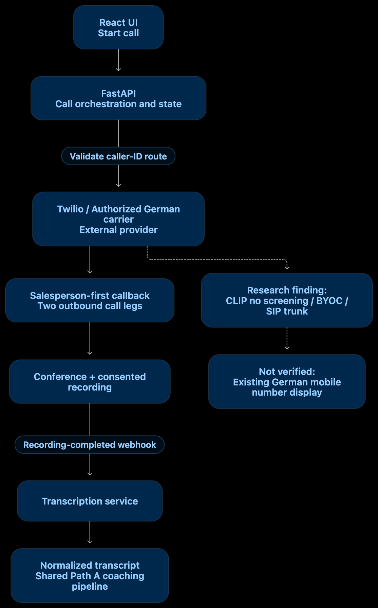
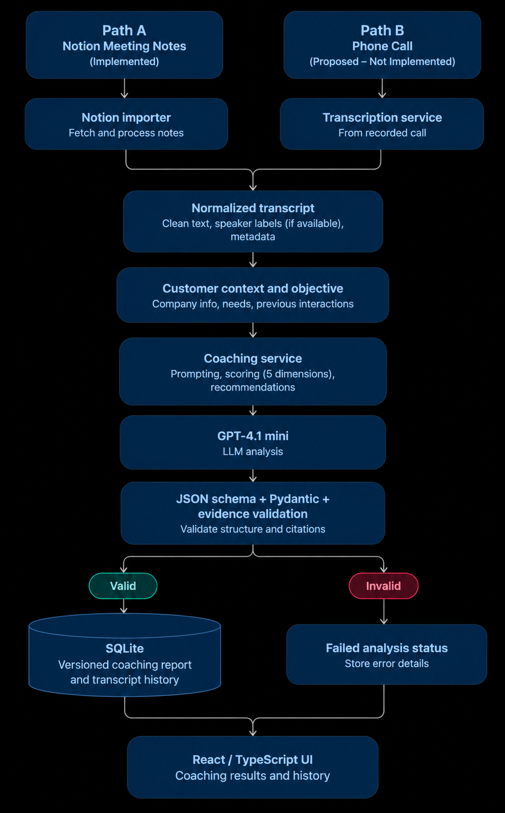

# Intellegam Sales Coaching

## What I built

I built a local web app that imports a sales meeting transcript, lets the user add customer context, and generates a coaching report. The report includes feedback, scores where the speaker roles are clear, and quotes that link back to the transcript. Previous reports are saved so they can be reviewed later.

I implemented **Path A: importing native Notion AI Meeting Notes**. I also designed **Path B: recording a salesperson-first phone call**, but did not build it.

**Tech stack:** React, TypeScript, Vite, Python, FastAPI, SQLite, and GPT-4.1 mini.

## Demo


https://github.com/user-attachments/assets/0d0fb9a2-bf74-43a0-ac30-2b1af03b1265


## What works

- Import a native Notion meeting transcript using the Notion API, and save it locally. The importer checks for repeated imports and changes to the source.
- Add or edit the customer's company, needs, previous interactions, and the goal of the conversation.
- Request a coaching report based on the transcript and customer context.
- Show five coaching areas, a summary, suggested improvements, and evidence from the conversation when the source provides reliable speaker roles.
- Check that quoted evidence really appears in the transcript. If speaker roles are missing, the app does not guess salesperson scores.
- Save reports and the context used for each report, and open earlier results from History.
- Click evidence in a report to find the matching text in the transcript.

## Architecture

### Path A — Notion import (implemented)



The React frontend sends an import request to FastAPI. The backend fetches the meeting notes from Notion, keeps the transcript text and available source information, and saves them in SQLite. When the user requests coaching, the backend sends the transcript and customer context to GPT-4.1 mini. It checks the structured response and its evidence before saving the report.

Notion handles the meeting recording and transcription. This app does not record meetings or create transcripts itself.

### Path B — Phone call (design only)



My proposed flow is to call the salesperson first and confirm they are available. Only then would the system call the customer and connect both calls. With consent, the call could be recorded, transcribed, and passed into the same coaching pipeline used in Path A.

This needs **two outbound call legs**, not one. I would use provider webhooks to track answered calls, failures, cancellations, and recording status.

The difficult requirement is showing the salesperson's **existing German mobile number** on the customer's phone. I looked at possible routes such as carrier-supported caller ID, SIP trunking, and BYOC, but I have **not verified** a working provider configuration. I would test this with the carrier and two real phones before allowing customer calls. I would not silently show a different number.

Reference: [Twilio regional availability](https://www.twilio.com/docs/global-infrastructure/regional-product-and-feature-availability).

### Shared coaching pipeline



Both paths would eventually produce a transcript that can be sent to the same coaching service. Path B's calling, recording, and transcription steps are not implemented.

## Why I made these choices

I chose Path A because I could build and test a useful end-to-end workflow within the challenge time. I used FastAPI because I am comfortable working with Python for APIs and LLM integrations. React and TypeScript handle the user interface, while SQLite keeps the local prototype simple.

I kept the original transcript separate from the coaching reports. Each saved report includes the context used for that analysis, so previous reports are not overwritten.

I also added checks around LLM output. The app verifies source references and exact quotations rather than accepting every generated quote. This does **not** mean the scores or recommendations are always correct; those still need human review.

For a production version, I would add authentication, stronger data protection, background workers, and clearer retention controls.

## Approximate cost of a 10-minute phone call

Path B would have several costs: calling the salesperson, calling the customer, recording, transcription, and AI analysis.

I used public pricing to make a **rough example for US domestic calls**. It is **not a quote for Germany** and does not confirm that the German caller-ID requirement can be met.

| Part | Example calculation | Cost |
| --- | --- | ---: |
| Two outbound calls | 2 × 10 minutes × $0.014/minute | $0.28 |
| Recording | 10 minutes × $0.0025/minute | $0.025 |
| Transcription | 2 × 10 minutes × $0.003/minute | $0.06 |
| GPT-4.1 mini analysis | 5,000 input and 2,000 output tokens | $0.0052 |
| **Illustrative total** | | **$0.3702** |

Pricing references: [Twilio US Voice](https://www.twilio.com/en-us/voice/pricing/us), [OpenAI API pricing](https://platform.openai.com/pricing/), and [GPT-4.1 mini](https://developers.openai.com/api/docs/models/gpt-4.1-mini).

This example excludes number rental, taxes, carrier/BYOC fees, storage, and other provider charges. Before building Path B, I would check the actual Germany-specific prices and caller-ID support with the selected provider. **These figures are planning assumptions, not prices I verified through a live call.**

Path A does not need a new transcription step because Notion already provides the transcript. Notion subscription or feature costs are separate. Generating a coaching report uses a paid OpenAI request; the app asks for explicit authorization before doing that.

## Run locally

You need Python 3.11+, Node.js compatible with Vite 7, a Notion integration token, and an OpenAI API key for live analysis.

From the project folder, set up the backend:

```bash
python3.11 -m venv .venv
source .venv/bin/activate
python -m pip install -r backend/requirements.txt
cp -n .env.example .env
```

Edit `.env` and set `NOTION_API_TOKEN`, `NOTION_VERSION=2026-03-11`, `OPENAI_API_KEY`, and `LLM_PROVIDER=openai`. Do not commit `.env` or API keys.

Start the backend:

```bash
LLM_PROVIDER=openai .venv/bin/python -m uvicorn app.main:create_app --factory --app-dir backend --host 127.0.0.1 --port 8000
```

In another terminal, start the frontend:

```bash
cd frontend
npm ci
npm run dev
```

Open <http://127.0.0.1:5173>.

### Try the app

For a real Notion import, create an integration with permission to read the meeting page, share the page with that integration, and use a native Notion AI Meeting Notes page that already has a completed transcript. The integration does not start the recording. See [Notion AI Meeting Notes](https://www.notion.com/help/ai-meeting-notes) and the [Notion API](https://developers.notion.com/reference/block#meeting-notes).

You can also select **Load offline demo** to use the included synthetic OmniSupport sales conversation (`kapibala-sim:mstate:S46_standard`). This fixture has known speaker roles and can be used to show a complete coaching report. Its [attribution](backend/tests/fixtures/external/ATTRIBUTION.md) and [dataset card](backend/tests/fixtures/external/dataset-card.md) are included. Generating a new report with OpenAI requires authorization and may incur a small charge.

## Tests

Backend:

```bash
.venv/bin/python -m pytest backend/tests -c backend/pytest.ini
```

Frontend (from `frontend/`):

```bash
npm run typecheck
npm run build
node tests/evidence-navigation.mjs
node tests/api-errors.mjs
```

**256 backend tests passed**, and the frontend typecheck and build passed in the tested environment. Most automated tests use mocks rather than live Notion or OpenAI requests. A completely fresh dependency installation was not verified.

## What I verified and what is still limited

I verified that a native Notion transcript could be retrieved and saved. However, the transcript I tested did not have reliable speaker attribution. I therefore could not demonstrate a fully scored report from that native Notion transcript. I demonstrated complete scored coaching using the synthetic fixture with known speaker roles instead.

The app also has a limited mode for missing speaker roles, but I have not demonstrated an accepted live native Notion limited report. The tested Notion transcript did not provide verified utterance timestamps.

Reports are limited to transcripts of 80–16,000 characters for analysis. Longer transcripts are stored without cutting the source text, but are not sent for coaching. Model-generated feedback still needs review for accuracy. Path B remains a design and has not been integrated or tested.

This is a local prototype, not a production service. It has no user login or automatic data-deletion workflow. Use only fictional or appropriately consented transcripts. Stored transcripts and reports may contain sensitive information, and text sent for analysis is processed by the configured AI provider.

## Development time and AI assistance

**Development time:** Approximately 8–9 hours of active work, including design, implementation, debugging, testing, and documentation.

**AI assistance:** I used OpenAI Codex to help with implementation, debugging, review, and tests. I directed the scope and architectural choices and reviewed the integration limits and verification results.
